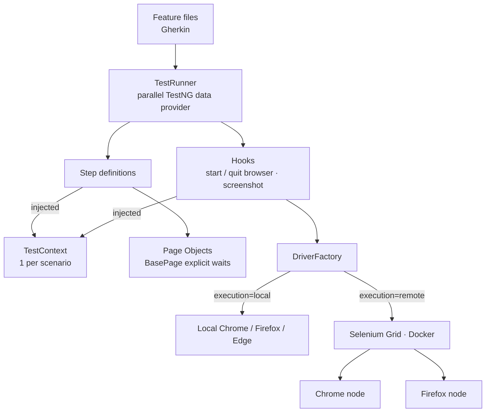
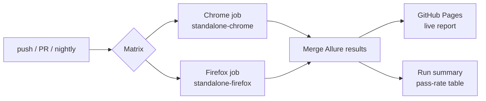

# Cucumber BDD + Selenium Grid Framework

[](https://github.com/AishwaryaAni/cucumber-selenium-grid-framework/actions/workflows/grid-tests.yml)
[](https://aishwaryaani.github.io/cucumber-selenium-grid-framework/)


A behaviour-driven UI automation framework that runs **the same Gherkin scenarios in parallel on Chrome and Firefox** inside a **Dockerised Selenium Grid**. It targets [the-internet](https://the-internet.herokuapp.com) — a practice site built around the UI patterns that make automation hard: native dialogs, nested iframes, multiple windows, AJAX loading, hover menus, HTML5 drag-and-drop, sortable tables and file upload.

### 📊 [View the live cross-browser Allure report →](https://aishwaryaani.github.io/cucumber-selenium-grid-framework/)
Rebuilt on every push and nightly at 09:30 IST — every scenario shown once per browser.

> Built by a QA Team Lead with 6 years of cross-browser, mobile and web testing. Feature files are written as plain-English acceptance criteria that BAs and manual testers can review; the automation underneath handles the hard parts.

---

## Highlights

- **BDD with Cucumber 7** — Gherkin features, Scenario Outlines, Backgrounds and tag-based selection (`@smoke`, `@regression`, `@alerts` …)
- **Selenium Grid 4 on Docker** — local `docker compose` grid (hub + Chrome + Firefox nodes) and per-browser Grid containers in CI
- **Cross-browser matrix** — Chrome and Firefox run as parallel CI jobs; results merged into one report
- **Parallel scenarios** — 4 concurrent browser sessions per node, isolated through PicoContainer dependency injection (one `TestContext` and one browser per scenario, no static drivers)
- **Advanced interactions** that commonly break naive scripts — see the table below
- **Remote file upload** — `LocalFileDetector` streams files from the runner to the Grid node
- **Zero `Thread.sleep()`** — every "eventually" is an explicit wait
- **Allure** with per-browser parameters and screenshot-on-failure; **Cucumber HTML** report as a second artifact
- **CI/CD** — GitHub Actions matrix → merged report → GitHub Pages, plus a pass-rate table in each run summary

---

## What the scenarios cover

| Feature | Technique demonstrated |
|---|---|
| Login | Form submission, positive + negative Scenario Outline |
| Asynchronous content | Waiting for elements that are hidden vs. not yet in the DOM; waiting for removal (`numberOfElementsToBe(…, 0)`) and enablement |
| Native dialogs | `alertIsPresent()` wait, then accept / dismiss / type into prompts |
| Frames & windows | Switching through **nested framesets**; opening, switching to, closing and returning from a **new window** |
| Mouse & keyboard | **Hover** (Actions API), **special keys**, **right-click** context menu, **HTML5 drag-and-drop** |
| Data & files | **Client-side sorted table** verified against a computed sort; **file upload through a remote Grid** |

**28 scenarios × 2 browsers = 56 executions per run.**

### Why the HTML5 drag-and-drop needs special handling
`Actions.dragAndDrop()` moves the mouse but doesn't fire the HTML5 `dragstart` / `drop` events, so the columns never swap — a classic false failure. `DragAndDropPage` dispatches the real `DragEvent` sequence with a shared `DataTransfer`, which works identically on Chrome and Firefox.

---

## Tech Stack

| Layer | Tool |
|---|---|
| Language | Java 17 |
| BDD | Cucumber 7 (Gherkin, cucumber-testng runner) |
| Dependency injection | Cucumber PicoContainer |
| Browser automation | Selenium WebDriver 4 — local or `RemoteWebDriver` |
| Grid | Selenium Grid 4 (Docker: `selenium/hub`, `node-chrome`, `node-firefox`, `standalone-*`) |
| Runner | TestNG 7 (parallel data provider) |
| Reporting | Allure 2 (`allure-cucumber7-jvm`), Cucumber HTML |
| Build | Maven |
| CI/CD | GitHub Actions matrix → GitHub Pages |

---

## Architecture





---

## Project Structure

```
cucumber-selenium-grid-framework
├── .github/workflows/grid-tests.yml      # matrix CI → merged Allure → Pages
├── docker-compose.yml                    # local hub + Chrome + Firefox nodes
├── pom.xml
└── src
    ├── main/java/com/qa/bdd
    │   ├── config/ConfigReader.java
    │   ├── driver/DriverFactory.java     # local vs remote, browser options, file detector
    │   └── pages                         # one Page Object per screen
    │       ├── BasePage.java · LoginPage.java
    │       ├── DynamicLoadingPage.java · DynamicControlsPage.java
    │       ├── JavaScriptAlertsPage.java · ContextMenuPage.java
    │       ├── FramesPage.java · WindowsPage.java
    │       ├── HoversPage.java · KeyPressesPage.java · DragAndDropPage.java
    │       └── TablesPage.java · FileUploadPage.java
    └── test
        ├── java/com/qa/bdd
        │   ├── context/TestContext.java  # scenario-scoped state (DI)
        │   ├── hooks/Hooks.java
        │   ├── runners/TestRunner.java
        │   └── steps/                    # Login · DynamicContent · Alert · FrameWindow · Interaction
        └── resources
            ├── features/                 # 6 feature files
            ├── config.properties · testng.xml
            └── allure.properties · cucumber.properties
```

---

## Getting Started

### Prerequisites
- **JDK 17+**, **Maven 3.8+**
- **Chrome / Firefox** for local runs
- **Docker** for Grid runs

### 1 — Run locally (no Docker)

```bash
git clone https://github.com/AishwaryaAni/cucumber-selenium-grid-framework.git
cd cucumber-selenium-grid-framework

mvn clean test                                   # Chrome, all @regression scenarios
mvn clean test -Dbrowser=firefox -Dheadless=true
mvn clean test "-Dcucumber.filter.tags=@smoke"
mvn clean test "-Dcucumber.filter.tags=@alerts or @interactions"
```

### 2 — Run on a local Selenium Grid (Docker)

```bash
docker compose up -d                    # hub + Chrome + Firefox nodes
# watch sessions live at http://localhost:4444/ui

mvn clean test -Dexecution=remote -Dbrowser=chrome
mvn clean test -Dexecution=remote -Dbrowser=firefox

docker compose down
```

### 3 — Reports

```bash
allure serve target/allure-results      # Allure (npm i -g allure-commandline)
open target/cucumber-report.html        # Cucumber HTML
```

---

## Configuration

| Key | Default | Override |
|---|---|---|
| `baseUrl` | `https://the-internet.herokuapp.com` | `-DbaseUrl=…` |
| `execution` | `local` | `-Dexecution=remote` |
| `grid.url` | `http://localhost:4444` | `-Dgrid.url=http://grid:4444` |
| `browser` | `chrome` | `-Dbrowser=firefox` / `edge` |
| `headless` | `false` | `-Dheadless=true` |
| `explicit.wait` | `15` s | `-Dexplicit.wait=20` |
| Scenario selection | all `@regression` (CI) | `-Dcucumber.filter.tags="@smoke and not @alerts"` |
| Parallel sessions | 4 | `data-provider-thread-count` in `testng.xml` |

---

## Design Decisions

- **PicoContainer over static/ThreadLocal drivers** — each scenario gets its own `TestContext`, so parallel scenarios can't leak state into each other.
- **Pages are created lazily inside steps** — they never touch the driver before the `@Before` hook has started it.
- **Frame helpers always return to the top document** (`finally { defaultContent() }`), so a failing frame step can't poison the next one.
- **Window helpers remember the original handle** and close only what they opened.
- **Sort verification is computed, not hard-coded** — the test sorts the values itself and compares, so it survives data changes.

---

## Related repositories

| Repo | Focus |
|---|---|
| 🖥️ [saucedemo-selenium-framework](https://github.com/AishwaryaAni/saucedemo-selenium-framework) | Selenium + TestNG, Page Object Model, e-commerce E2E |
| 🔌 [restful-booker-api-automation](https://github.com/AishwaryaAni/restful-booker-api-automation) | REST Assured API testing, JSON schema contracts, live Allure report |
| 🥒 **cucumber-selenium-grid-framework** | BDD, Selenium Grid on Docker, parallel cross-browser |

## Author

**Aishwarya Anil** — Senior QA Engineer · QA Team Lead
Manual · API · Database · UI Automation

[LinkedIn](https://linkedin.com/in/aishwarya-anil20) · [GitHub](https://github.com/AishwaryaAni)
